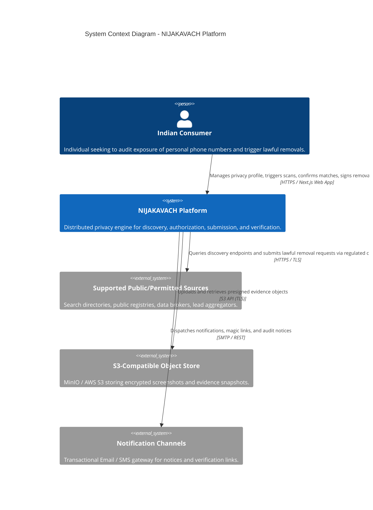
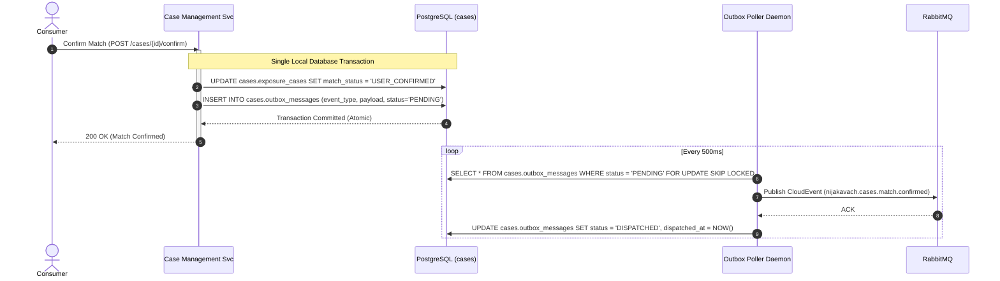
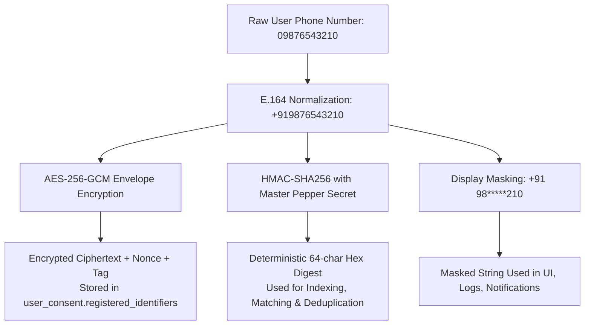

# NIJAKAVACH (निजकवच) — System Architecture Document

---

## 1. Architecture Overview

**NIJAKAVACH (निजकवच)** is an enterprise-grade privacy engineering platform engineered for Indian consumers to discover where their personal information (commencing with telephone numbers) is exposed across public directories, data brokers, and lead aggregators, and to orchestrate lawful, evidence-backed removal and opt-out workflows.

The system is architected as an event-driven, distributed microservices monorepo. It explicitly avoids monolithic coupling, synchronous request cascades, and opaque status claims. Every discovery, review, authorization, submission, tracking, and verification phase operates with explicit state boundaries and complete cryptographic auditability.

### Core Product Journey

```
[DISCOVER] ───> [REVIEW] ───> [AUTHORISE] ───> [SUBMIT] ───> [TRACK] ───> [VERIFY]
```

1. **DISCOVER**: Automated background scan jobs query lawful, public sources within legal and rate-limit constraints without bypassing access protections.
2. **REVIEW**: Consumers inspect discovered match candidates alongside immutable point-in-time cryptographic evidence (DOM snippet, SHA-256 digest, S3 storage key).
3. **AUTHORISE**: Consumer confirms whether a listing belongs to them and signs an explicit statutory authorization under **Section 12 of the Digital Personal Data Protection Act, 2023 (DPDP Act)** (Right to Correction and Erasure).
4. **SUBMIT**: Lawful removal payload is formatted and dispatched via supported channel (API, webform, or grievance email).
5. **TRACK**: Tracks source ticket IDs, acknowledgments, additional action requirements, or formal rejection notices.
6. **VERIFY**: Independent scheduled rechecks verify whether data was genuinely expunged, distinguishing source claims from independent verification, and actively surveillance sources for relisting.

> **CRITICAL ARCHITECTURAL DISTINCTION**:  
> A submitted request or source acknowledgement is **never** treated as a completed removal. Removal is only established after independent verification rechecks.

### High-Level System Context (C4 Context Diagram)



### Exposure Lifecycle State Machine

| State Code | State Name | Description | Transitions Allowed To |
| :--- | :--- | :--- | :--- |
| `POTENTIAL_EXPOSURE_DISCOVERED` | Potential Exposure Discovered | Raw match candidate detected by source worker. Awaiting user evaluation. | `MATCH_CONFIRMED`, `DISMISSED_AS_FALSE_POSITIVE` |
| `MATCH_CONFIRMED` | Match Confirmed | User confirmed the listing contains their personal data. | `AWAITING_USER_AUTHORISATION`, `CLOSED_NO_ACTION` |
| `DISMISSED_AS_FALSE_POSITIVE` | Dismissed False Positive | User confirmed the listing does not belong to them. | `CLOSED_NO_ACTION` |
| `AWAITING_USER_AUTHORISATION` | Awaiting Authorization | Case prepared; requires explicit electronic consent & authorization artifact. | `REQUEST_PREPARED`, `CLOSED_NO_ACTION` |
| `REQUEST_PREPARED` | Request Prepared | Removal payload generated with legal citations and required metadata. | `REQUEST_SUBMITTED`, `SUBMISSION_FAILED` |
| `REQUEST_SUBMITTED` | Request Submitted | Payload dispatched to source via API, webform, or compliance email. | `REQUEST_ACKNOWLEDGED`, `REQUEST_REJECTED`, `SUBMISSION_FAILED` |
| `REQUEST_ACKNOWLEDGED` | Request Acknowledged | Source ticket ID or acknowledgment response received. | `ADDITIONAL_ACTION_REQUIRED`, `SOURCE_REPORTS_REMOVAL`, `REQUEST_REJECTED` |
| `ADDITIONAL_ACTION_REQUIRED` | Additional Action Required | Source demands user verification, proof of identity, or supplementary data. | `REQUEST_SUBMITTED`, `CLOSED_UNRESOLVED` |
| `REQUEST_REJECTED` | Request Rejected | Source refused removal with formal justification or non-compliance. | `CLOSED_REJECTED`, `ESCALATED_MANUAL` |
| `SOURCE_REPORTS_REMOVAL` | Source Reports Removal | Source claims the data has been expunged or de-indexed. | `VERIFICATION_SCHEDULED` |
| `REMOVAL_INDEPENDENTLY_VERIFIED`| Removal Independently Verified | Re-check worker verified the target personal data is no longer accessible. | `MONITORING_ACTIVE` |
| `UNABLE_TO_VERIFY` | Unable to Verify | Endpoint timed out or source structure altered preventing verification. | `VERIFICATION_SCHEDULED`, `ESCALATED_MANUAL` |
| `INFORMATION_REAPPEARED` | Information Reappeared | Recurring monitor scan detected previously removed data has relisted. | `POTENTIAL_EXPOSURE_DISCOVERED`, `REQUEST_PREPARED` |

---

## 2. Technology Stack

| Layer | Technology | Version / Specification | Architectural Purpose |
| :--- | :--- | :--- | :--- |
| **Monorepo Engine** | Turborepo + pnpm | Turborepo 2.x, pnpm 12.x | High-performance build caching, strict package symlinks, isolated workspace graph. |
| **Frontend** | Next.js, React, Tailwind CSS | Next.js 14.x, React 18.x, Tailwind 3.4 | Responsive, accessible consumer portal with 6-stage journey tracking and evidence inspection. |
| **Backend Runtimes** | Node.js, TypeScript | Node.js 20/24 LTS, TypeScript 5.8 | Strict compiler mode (`noImplicitAny`, `noUncheckedIndexedAccess`, `strictNullChecks`). |
| **Primary Database** | PostgreSQL | PostgreSQL 16 Alpine | Relational transactional engine partitioned into 9 logical schemas with least-privilege roles. |
| **Coordination & Cache** | Redis | Redis 7 Alpine | Rate-limiting sliding windows, token blocklisting, distributed locks (Redlock). |
| **Message Broker** | RabbitMQ | RabbitMQ 3.13 Management | Durable work queues, Topic domain events, Dead-Letter Exchanges (`*.dlx`) with exponential backoff. |
| **Evidence Storage** | MinIO / AWS S3 | S3 API Compliant | Encrypted binary storage for screenshots, DOM snapshots, and statutory correspondence. |
| **Data Validation** | Zod | Zod 3.24 | Shared compile-time and runtime validation contracts across client and server. |
| **Security & Crypto** | Node.js Crypto, JWT | AES-256-GCM, HMAC-SHA256, Scrypt | Authenticated envelope encryption, keyed lookup indexing, password hashing, stateless tokens. |

---

## 3. Microservices and Responsibilities

```mermaid
graph TD
    Client[Next.js Web Frontend\napps/web :3000] -->|HTTPS / REST| Gateway[API Gateway / BFF\napps/api-gateway :4000]
    
    subgraph Synchronous Service Mesh
        Gateway -->|JWT / Internal Key| IdentitySvc[Identity Service\napps/identity-service :4001]
        Gateway -->|JWT / Internal Key| UserSvc[User & Consent Service\napps/user-service :4002]
        Gateway -->|JWT / Internal Key| SourceRegSvc[Source Registry Service\napps/source-registry-service :4003]
        Gateway -->|JWT / Internal Key| DiscoverySvc[Discovery Service\napps/discovery-service :4004]
        Gateway -->|JWT / Internal Key| CaseMgmtSvc[Case Management Service\napps/case-management-service :4005]
        Gateway -->|JWT / Internal Key| RemovalSvc[Removal Workflow Service\napps/removal-workflow-service :4006]
        Gateway -->|JWT / Internal Key| VerificationSvc[Verification Service\napps/verification-service :4007]
        Gateway -->|Internal Key| AuditSvc[Audit Service\napps/audit-service :4009]
    end

    subgraph Messaging & Worker Tier
        DiscoverySvc -->|Publish Scan Jobs| RabbitMQ[(RabbitMQ 3.13)]
        RabbitMQ -->|Consume Scan Jobs| SourceWorkers[Source Adapter Workers\napps/source-workers :4010]
        SourceWorkers -->|Publish CandidateFound| RabbitMQ
        RabbitMQ -->|Ingest Candidates| CaseMgmtSvc
        
        RemovalSvc -->|Publish Removal Jobs| RabbitMQ
        RabbitMQ -->|Consume Removal Submissions| SourceWorkers
        
        VerificationSvc -->|Publish Recheck Jobs| RabbitMQ
        RabbitMQ -->|Execute Recheck| SourceWorkers
        
        Outbox[Transactional Outbox Engines] -->|Publish Domain Events| RabbitMQ
        RabbitMQ -->|Events| NotificationSvc[Notification Service\napps/notification-service :4008]
        RabbitMQ -->|Security Events| AuditSvc
    end

    subgraph Data Tier (Logical Schemas in PostgreSQL 16)
        IdentitySvc --> DB_Id[(PostgreSQL: identity)]
        UserSvc --> DB_Usr[(PostgreSQL: user_consent)]
        SourceRegSvc --> DB_Src[(PostgreSQL: sources)]
        DiscoverySvc --> DB_Disc[(PostgreSQL: discovery)]
        CaseMgmtSvc --> DB_Case[(PostgreSQL: cases)]
        RemovalSvc --> DB_Rem[(PostgreSQL: removals)]
        VerificationSvc --> DB_Ver[(PostgreSQL: verification)]
        NotificationSvc --> DB_Notif[(PostgreSQL: notifications)]
        AuditSvc --> DB_Aud[(PostgreSQL: audit)]
        SourceWorkers --> S3[(MinIO / S3 Object Store)]
    end
```

### Microservice Catalog

| Service Name | Port | Owned Schema / Target | Primary Responsibilities |
| :--- | :--- | :--- | :--- |
| **API Gateway / BFF** (`apps/api-gateway`) | `4000` | Stateless (Redis) | Single public entry point, route dispatch, TLS termination, CORS, CSRF, security headers, correlation ID generation. |
| **Identity Service** (`apps/identity-service`) | `4001` | `identity` | Registration, Scrypt password hashing, session tokens, refresh token rotation, security event logging. |
| **User & Consent Service** (`apps/user-service`) | `4002` | `user_consent` | Phone number registration, HMAC-SHA256 fingerprinting, AES-256-GCM encryption, DPDP explicit consent records, erasure workflows. |
| **Source Registry Service** (`apps/source-registry-service`) | `4003` | `sources` | Supported source directory, capabilities (`SEARCHABLE`, `WEBFORM_OPT_OUT`, `EMAIL_NOTICE_REMOVAL`), rate limits, health metrics. |
| **Discovery Service** (`apps/discovery-service`) | `4004` | `discovery` | Orchestrates discovery scans across verified identifiers, dispatches jobs to RabbitMQ queues, monitors execution progress. |
| **Case Management Service** (`apps/case-management-service`) | `4005` | `cases` | Authoritative exposure state machine, match confirmation (`MATCH_CONFIRMED`), dismissal, presigned S3 evidence link generation. |
| **Removal Workflow Service** (`apps/removal-workflow-service`) | `4006` | `removals` | Prepares statutory DPDP Sec 12 notices, verifies explicit user electronic authorization, queues submission jobs, tracks acknowledgments. |
| **Verification Service** (`apps/verification-service`) | `4007` | `verification` | Independent rechecks ($T+24h$, $T+7d$, $T+30d$), relist detection (`ExposureRelisted`), strictly separates source claims from independent verification. |
| **Notification Service** (`apps/notification-service`) | `4008` | `notifications` | Transactional notifications (email/SMS alerts), delivery logs, user notification preferences. |
| **Audit Service** (`apps/audit-service`) | `4009` | `audit` | Centralized immutable append-only ledger with cryptographically chained SHA-256 block hashes (`entryHash = SHA256(prevHash + timestamp + payload)`). |
| **Source Workers** (`apps/source-workers`) | `4010` | S3 / MinIO | Asynchronous worker daemon processing discovery checks, removal submissions, and verification rechecks against lawful external endpoints. |
| **Web Frontend** (`apps/web`) | `3000` | Client UI | Next.js 14 client application with 6-stage privacy journey tracking, phone scanner, evidence snapshot inspector, and DPDP authorization. |

---

## 4. Service Communication

### A. Synchronous HTTP Ingress
- Client browser requests enter through the **API Gateway** (`apps/api-gateway:4000`) over HTTPS.
- Gateway injects standard security headers (`Content-Security-Policy`, `Strict-Transport-Security`, `X-Content-Type-Options: nosniff`, `X-Frame-Options: DENY`).
- Gateway generates a unique correlation ID (`X-Correlation-Id: corr-<uuid>`) if not present, and forwards requests to internal microservices with `X-User-Id` and `X-Internal-Service-Key`.

### B. Asynchronous Event-Driven Messaging
- RabbitMQ 3.13 acts as the central asynchronous nervous system.
- Exchange topology:
  - `nijakavach.jobs.direct`: Direct exchange for point-to-point worker tasks (`discovery.source-check`, `removal.submit`, `verification.recheck`).
  - `nijakavach.events.topic`: Topic exchange for distributed domain events (`nijakavach.#`).
  - Dead-Letter Exchanges (`jobs.discovery.dlx`, `jobs.removal.dlx`) capture poison pills and exhausted retries.
- Consumers acknowledge messages only after durable persistence (`ack`/`nack`). Retry policy uses exponential backoff with full jitter up to 5 attempts before routing to dead-letter queues.

---

## 5. Database Architecture

### A. Service Ownership & Database Topology

NIJAKAVACH enforces a **Logical Schema Ownership Model** within PostgreSQL 16. Each microservice acts as the sole custodian of its dedicated PostgreSQL schema, possessing exclusive write and migration authority.

```mermaid
graph TD
    subgraph Logical Schemas in PostgreSQL 16
        subgraph S1 [identity]
            ID_T[accounts, credentials, sessions, email_verifications, security_events, outbox_messages]
        end
        subgraph S2 [user_consent]
            UC_T[user_profiles, personal_identifiers, consent_records, authorisation_records, data_deletion_requests, outbox_messages]
        end
        subgraph S3 [sources]
            SR_T[sources, source_capabilities, source_health_records, source_policies, outbox_messages]
        end
        subgraph S4 [discovery]
            DC_T[scans, scan_targets, source_checks, scan_results, outbox_messages]
        end
        subgraph S5 [cases]
            CS_T[exposure_cases, exposure_observations, exposure_match_reviews, evidence_metadata, case_status_history, outbox_messages]
        end
        subgraph S6 [removals]
            RM_T[removal_requests, removal_submissions, removal_responses, removal_status_history, outbox_messages]
        end
        subgraph S7 [verification]
            VR_T[verification_jobs, verification_attempts, relisting_records, outbox_messages]
        end
        subgraph S8 [notifications]
            NT_T[notification_logs, notification_preferences, outbox_messages]
        end
        subgraph S9 [audit]
            AU_T[audit_events]
        end
    end

    Role1[identity_svc_role] -.->|Exclusive Access| S1
    Role2[user_svc_role] -.->|Exclusive Access| S2
    Role3[sources_svc_role] -.->|Exclusive Access| S3
    Role4[discovery_svc_role] -.->|Exclusive Access| S4
    Role5[cases_svc_role] -.->|Exclusive Access| S5
    Role6[removals_svc_role] -.->|Exclusive Access| S6
    Role7[verification_svc_role] -.->|Exclusive Access| S7
    Role8[notifications_svc_role] -.->|Exclusive Access| S8
    Role9[audit_svc_role] -.->|Exclusive Access| S9
```



#### Ownership & Least-Privilege Role Matrix

| Microservice | PostgreSQL Schema | Database Role | Permissions | Migration / DDL Authority |
| :--- | :--- | :--- | :--- | :--- |
| **Identity Service** | `identity` | `identity_svc_role` | `ALL` on `identity.*` only | Owns `001`, `002` identity DDL |
| **User & Consent Service** | `user_consent` | `user_svc_role` | `ALL` on `user_consent.*` only | Owns personal identifiers & consent DDL |
| **Source Registry Service** | `sources` | `sources_svc_role` | `ALL` on `sources.*` only | Owns directory sources & policies DDL |
| **Discovery Service** | `discovery` | `discovery_svc_role` | `ALL` on `discovery.*` only | Owns scans & checks DDL |
| **Case Management Service** | `cases` | `cases_svc_role` | `ALL` on `cases.*` only | Owns exposure cases & evidence metadata DDL |
| **Removal Workflow Service** | `removals` | `removals_svc_role` | `ALL` on `removals.*` only | Owns removal submissions & tracking DDL |
| **Verification Service** | `verification` | `verification_svc_role` | `ALL` on `verification.*` only | Owns verification runs & relisting DDL |
| **Notification Service** | `notifications` | `notifications_svc_role` | `ALL` on `notifications.*` only | Owns notification delivery logs & prefs DDL |
| **Audit Service** | `audit` | `audit_svc_role` | `INSERT`, `SELECT` on `audit.*` (Append-Only) | Owns cryptographic audit ledger DDL |

#### Rules of Database Boundary Isolation
1. **Zero Cross-Schema Foreign Keys**: Physical `REFERENCES other_schema.other_table` declarations are strictly forbidden. All inter-service relationships are established using stable, immutable UUIDs (`account_id`, `user_profile_id`, `source_id`, `case_id`).
2. **Zero Cross-Schema SQL Queries**: Services never execute SQL joins (`JOIN schema_b.table_y`) across schema boundaries. Inter-service data retrieval occurs exclusively via authenticated REST APIs or asynchronous event streams.
3. **No Unrestricted Shared Roles**: No application service connects using the superuser `postgres` role in production. Each service authenticates with its designated least-privilege credentials.
4. **Independent Physical Migration Path**: Because schemas share zero physical constraints or joins, any individual schema (e.g. high-volume `cases` or `discovery`) can be detached and migrated to an independent AWS Aurora / RDS PostgreSQL instance by updating service connection strings without changing a single line of SQL or application logic.

---

### B. Entity Catalogue

#### 1. Identity Domain (`identity`)
Responsible for account credentialing, session lifecycle, and authentication security.
- **`identity.accounts`**: Core user accounts. Columns: `id` (UUID PK), `email` (VARCHAR UNIQUE), `email_verified` (BOOLEAN), `status` (CHECK: `ACTIVE`, `SUSPENDED`, `PENDING_VERIFICATION`, `DELETED`), `created_at`, `updated_at`.
- **`identity.credentials`**: Password hash storage. Columns: `id` (UUID PK), `account_id` (FK -> `accounts.id`), `password_hash` (VARCHAR Scrypt/Argon2), `password_version` (INT), `created_at`, `updated_at`.
- **`identity.sessions`**: Stateful user session tokens. Columns: `id` (UUID PK), `account_id` (FK -> `accounts.id`), `session_token_hash` (VARCHAR(64) UNIQUE), `ip_address`, `user_agent`, `expires_at`, `revoked_at`, `created_at`.
- **`identity.email_verifications`**: OTP/magic link tokens. Columns: `id` (UUID PK), `account_id` (FK -> `accounts.id`), `token_hash` (VARCHAR(64) UNIQUE), `expires_at`, `consumed_at`, `created_at`.
- **`identity.security_events`**: Security audit log. Columns: `id` (UUID PK), `account_id` (UUID NULLABLE), `event_type` (CHECK: `LOGIN_SUCCESS`, `LOGIN_FAILED`, `PASSWORD_RESET`, `ACCOUNT_LOCKED`, `SESSION_REVOKED`), `ip_address`, `user_agent`, `metadata` (JSONB), `created_at`.
- **`identity.outbox_messages`**: Transactional outbox for identity domain events.

#### 2. User & Consent Domain (`user_consent`)
Responsible for user privacy profile, encrypted personal identifiers, DPDP statutory consents, and erasure requests.
- **`user_consent.user_profiles`**: User profile attributes. Columns: `id` (UUID PK), `account_id` (UUID UNIQUE conceptual link to `identity.accounts`), `full_name`, `locale`, `timezone`, `created_at`, `updated_at`.
- **`user_consent.personal_identifiers`**: Encrypted identifiers for discovery. Columns: `id` (UUID PK), `user_profile_id` (FK -> `user_profiles.id`), `identifier_type` (CHECK: `PHONE_NUMBER`, `EMAIL_ADDRESS`), `encrypted_value` (AES-256-GCM ciphertext + IV + auth tag), `key_version` (VARCHAR(16)), `hmac_fingerprint` (VARCHAR(64) deterministic keyed lookup), `masked_display` (VARCHAR(64) e.g. `+91 98*****210`), `verification_status` (CHECK: `PENDING_VERIFICATION`, `VERIFIED`, `REVOKED`), `verified_at`, `created_at`, `updated_at`. Composite UNIQUE (`user_profile_id`, `hmac_fingerprint`).
- **`user_consent.consent_records`**: Auditable DPDP statutory consent records. Columns: `id` (UUID PK), `user_profile_id` (FK -> `user_profiles.id`), `purpose_code` (CHECK: `PURPOSE_DISCOVERY_SCAN`, `PURPOSE_REMOVAL_SUBMISSION`, `PURPOSE_PERSISTENT_MONITORING`), `statutory_basis` (Default `DPDP_ACT_2023_SECTION_6`), `notice_version`, `notice_hash_sha256` (cryptographic hash of exact wording shown), `ip_address`, `status` (CHECK: `ACTIVE`, `WITHDRAWN`, `EXPIRED`), `granted_at`, `withdrawn_at`, `withdrawal_reason`.
- **`user_consent.authorisation_records`**: Case-specific removal authorization artifacts. Columns: `id` (UUID PK), `user_profile_id` (FK -> `user_profiles.id`), `case_id` (UUID conceptual link to `cases.exposure_cases`), `source_id` (UUID conceptual link to `sources.sources`), `statutory_basis` (`DPDP_ACT_2023_SECTION_12`), `authorisation_statement` (TEXT), `signature_proof` (VARCHAR), `authorised_at`, `revoked_at`.
- **`user_consent.data_deletion_requests`**: DPDP Sec 12 Erasure requests. Columns: `id` (UUID PK), `user_profile_id` (FK -> `user_profiles.id`), `statutory_basis`, `status` (CHECK: `RECEIVED`, `PROCESSING`, `COMPLETED`, `REJECTED`), `requested_at`, `completed_at`.
- **`user_consent.outbox_messages`**: Transactional outbox for user and consent events.

#### 3. Source Registry Domain (`sources`)
Responsible for cataloging lawful public directories, lead aggregators, opt-out capabilities, and operational health.
- **`sources.sources`**: Directory source definitions. Columns: `id` (UUID PK), `name` (VARCHAR(128) UNIQUE), `slug` (VARCHAR(64) UNIQUE), `category` (CHECK: `PUBLIC_DIRECTORY`, `LEAD_AGGREGATOR`, `B2B_REGISTRY`, `PEOPLE_SEARCH`), `base_url`, `operational_status` (CHECK: `OPERATIONAL`, `DEGRADED`, `UNAVAILABLE`, `DISCONTINUED`), `rate_limit_per_minute` (INT), `created_at`, `updated_at`.
- **`sources.source_capabilities`**: Granular discovery and removal capabilities. Columns: `id` (UUID PK), `source_id` (FK -> `sources.id`), `capability_type` (CHECK: `SEARCHABLE`, `AUTOMATED_API_REMOVAL`, `WEBFORM_OPT_OUT`, `EMAIL_NOTICE_REMOVAL`), `supported_identifier_types` (VARCHAR[]), `access_method` (CHECK: `PUBLIC_HTML_GET`, `PUBLIC_REST_API`, `WEBFORM_POST`, `GRIEVANCE_EMAIL`), `applicable_restrictions`, `compliance_endpoint`, `grievance_officer_email`. Composite UNIQUE (`source_id`, `capability_type`).
- **`sources.source_health_records`**: Periodic availability telemetry. Columns: `id` (UUID PK), `source_id` (FK -> `sources.id`), `latency_ms`, `http_status`, `health_status` (CHECK: `OPERATIONAL`, `DEGRADED`, `UNAVAILABLE`), `checked_at`.
- **`sources.source_policies`**: Statutory compliance terms and Grievance Officer details. Columns: `id` (UUID PK), `source_id` (FK -> `sources.id`), `statutory_framework` (`DPDP_ACT_2023`), `grievance_officer_email`, `postal_address`, `policy_version`, `terms_url`, `updated_at`.
- **`sources.outbox_messages`**: Transactional outbox for source registry events.

#### 4. Discovery Domain (`discovery`)
Responsible for asynchronous scan orchestration, execution state tracking, and source-level checks.
- **`discovery.scans`**: High-level consumer discovery scan jobs. Columns: `id` (UUID PK), `user_id` (UUID conceptual link), `status` (CHECK: `QUEUED`, `IN_PROGRESS`, `COMPLETED`, `FAILED`, `CANCELLED`), `total_targets` (INT), `completed_targets` (INT), `initiated_at`, `completed_at`.
- **`discovery.scan_targets`**: Identifier targets participating in a scan. Columns: `id` (UUID PK), `scan_id` (FK -> `scans.id`), `identifier_id` (UUID conceptual link to `user_consent.personal_identifiers`), `identifier_fingerprint` (VARCHAR(64)), `status` (CHECK: `PENDING`, `IN_PROGRESS`, `DONE`, `FAILED`).
- **`discovery.source_checks`**: Traceable check of one source for one target. Columns: `id` (UUID PK), `scan_id` (FK -> `scans.id`), `source_id` (UUID conceptual link to `sources.sources`), `identifier_fingerprint` (VARCHAR(64)), `status` (CHECK: `QUEUED`, `IN_PROGRESS`, `COMPLETED`, `FAILED`, `RETRYING`, `RATE_LIMITED`), `retry_count`, `failure_reason`, `started_at`, `completed_at`.
- **`discovery.scan_results`**: Raw findings from a check. Columns: `id` (UUID PK), `source_check_id` (FK -> `source_checks.id`), `found_exposure` (BOOLEAN), `raw_evidence_s3_key` (VARCHAR), `evidence_sha256` (VARCHAR(64)), `result_metadata` (JSONB), `observed_at`.
- **`discovery.outbox_messages`**: Transactional outbox for discovery events.

#### 5. Case Management Domain (`cases`)
Responsible for authoritative exposure lifecycle states, user match reviews, and cryptographic evidence metadata.
- **`cases.exposure_cases`**: Authoritative exposure record. Columns: `id` (UUID PK), `user_id` (UUID), `source_id` (UUID), `identifier_fingerprint` (VARCHAR(64)), `masked_identifier` (VARCHAR(64)), `match_status` (CHECK: `POTENTIAL_MATCH`, `USER_CONFIRMED`, `USER_REJECTED`, `UNCERTAIN`, `FALSE_POSITIVE`), `lifecycle_state` (CHECK: `DISCOVERED`, `REVIEWED`, `AUTHORISED`, `SUBMITTED`, `TRACKED`, `VERIFIED_REMOVED`, `VERIFICATION_FAILED`, `CLOSED`), `first_observed_at`, `last_observed_at`, `created_at`, `updated_at`. Composite UNIQUE (`user_id`, `source_id`, `identifier_fingerprint`).
- **`cases.exposure_observations`**: Point-in-time observations across repeated checks. Columns: `id` (UUID PK), `case_id` (FK -> `exposure_cases.id`), `scan_result_id` (UUID), `observed_url`, `observation_snippet`, `observed_at`.
- **`cases.exposure_match_reviews`**: Explicit user review decision trail. Columns: `id` (UUID PK), `case_id` (FK -> `exposure_cases.id`), `user_id` (UUID), `review_decision` (CHECK: `CONFIRMED`, `REJECTED`, `UNCERTAIN`), `review_notes`, `reviewed_at`.
- **`cases.evidence_metadata`**: Object storage pointer & tamper-evident hashes. Columns: `id` (UUID PK), `case_id` (FK -> `exposure_cases.id`), `s3_object_key` (VARCHAR(512)), `content_type` (VARCHAR(64)), `size_bytes` (BIGINT), `sha256_checksum` (VARCHAR(64)), `access_classification` (`CONFIDENTIAL_PII_EVIDENCE`), `retention_days` (Default 365), `captured_at`.
- **`cases.case_status_history`**: Audit trail of case state transitions. Columns: `id` (UUID PK), `case_id` (FK -> `exposure_cases.id`), `from_state`, `to_state`, `transition_reason`, `actor_id`, `created_at`.
- **`cases.outbox_messages`**: Transactional outbox for case events.

#### 6. Removal Workflow Domain (`removals`)
Responsible for preparation, idempotent dispatch, and response tracking of statutory DPDP removal requests.
- **`removals.removal_requests`**: Removal orchestrations. Columns: `id` (UUID PK), `case_id` (UUID UNIQUE conceptual link to `cases.exposure_cases`), `user_id` (UUID), `source_id` (UUID), `statutory_basis` (`DPDP_ACT_2023_SECTION_12`), `state` (CHECK: `REQUEST_PREPARED`, `SUBMITTED`, `ACKNOWLEDGED`, `ADDITIONAL_ACTION_REQUIRED`, `REJECTED`, `SOURCE_REPORTS_REMOVAL`), `authorisation_id` (UUID link to signed authorization), `created_at`, `updated_at`.
- **`removals.removal_submissions`**: Idempotent transmission records. Columns: `id` (UUID PK), `removal_request_id` (FK -> `removal_requests.id`), `submission_channel` (CHECK: `GRIEVANCE_EMAIL`, `WEBFORM_POST`, `AUTOMATED_API`, `REGISTERED_POST`), `idempotency_key` (VARCHAR(64) UNIQUE), `payload_digest_sha256` (VARCHAR(64)), `attempt_number` (INT), `status` (CHECK: `SENT`, `DELIVERY_CONFIRMED`, `DELIVERY_FAILED`), `submitted_at`.
- **`removals.removal_responses`**: Formal source communications and ticket receipts. Columns: `id` (UUID PK), `removal_request_id` (FK -> `removal_requests.id`), `source_reference_ticket` (VARCHAR(128)), `response_type` (CHECK: `ACKNOWLEDGEMENT`, `DEMAND_FOR_INFO`, `REMOVAL_CONFIRMED`, `REJECTION_NOTICE`), `response_body` (TEXT), `received_at`.
- **`removals.removal_status_history`**: State progression audit log. Columns: `id` (UUID PK), `removal_request_id` (FK -> `removal_requests.id`), `from_state`, `to_state`, `notes`, `created_at`.
- **`removals.outbox_messages`**: Transactional outbox for removal events.

#### 7. Verification Domain (`verification`)
Responsible for independent rechecks, distinguishing source claims from observed reality, and relisting detection.
- **`verification.verification_jobs`**: Scheduled independent verification runs. Columns: `id` (UUID PK), `case_id` (UUID), `removal_request_id` (UUID), `source_id` (UUID), `identifier_fingerprint` (VARCHAR(64)), `status` (CHECK: `PENDING`, `IN_PROGRESS`, `COMPLETED`, `FAILED`), `scheduled_for` (TIMESTAMPTZ), `created_at`.
- **`verification.verification_attempts`**: Concrete recheck attempts. Columns: `id` (UUID PK), `job_id` (FK -> `verification_jobs.id`), `attempt_number` (INT), `observed_at`, `evidence_s3_key`, `evidence_sha256`, `result` (CHECK: `STILL_OBSERVABLE`, `INDEPENDENTLY_VERIFIED_REMOVED`, `SOURCE_REPORTED_ONLY`, `UNABLE_TO_VERIFY`, `POSSIBLE_RELISTING`), `notes`.
- **`verification.relisting_records`**: Recurring surveillance records detecting reappearance of expunged PII. Columns: `id` (UUID PK), `case_id` (UUID), `source_id` (UUID), `previous_verified_removal_at`, `relisted_detected_at`, `new_evidence_s3_key`, `alert_dispatched` (BOOLEAN).
- **`verification.outbox_messages`**: Transactional outbox for verification events.

#### 8. Notification Domain (`notifications`)
Responsible for multi-channel user alerts (email/SMS) and preference management.
- **`notifications.notification_logs`**: Delivery tracking. Columns: `id` (UUID PK), `user_id` (UUID), `channel` (CHECK: `EMAIL`, `IN_APP`, `SMS`), `template_code`, `delivery_status` (CHECK: `QUEUED`, `DISPATCHED`, `DELIVERED`, `FAILED`), `retry_count`, `failure_reason`, `correlation_id`, `sent_at`, `created_at`.
- **`notifications.notification_preferences`**: User alert settings. Columns: `id` (UUID PK), `user_id` (UUID UNIQUE), `email_enabled`, `scan_complete_alert`, `removal_status_alert`, `relist_critical_alert`, `updated_at`.
- **`notifications.outbox_messages`**: Transactional outbox for notification events.

#### 9. Audit Domain (`audit`)
Responsible for immutable, centralized compliance logging.
- **`audit.audit_events`**: Append-only cryptographic ledger. Columns: `id` (UUID PK), `actor_type` (CHECK: `USER`, `SYSTEM_DAEMON`, `COMPLIANCE_OFFICER`), `actor_id`, `action`, `entity_type`, `entity_id`, `correlation_id`, `payload_digest_sha256`, `outcome` (CHECK: `SUCCESS`, `DENIED`, `FAILURE`), `previous_block_hash` (VARCHAR(64)), `block_hash` (VARCHAR(64)), `timestamp`.

---

### C. Conceptual Relationships & Mermaid ER Diagrams

#### 1. Multi-Domain Conceptual Entity Relationship Diagram

```mermaid
erDiagram
    %% Identity Domain
    ACCOUNTS ||--o{ SESSIONS : "authenticates"
    ACCOUNTS ||--o| USER_PROFILES : "1:1 stable UUID reference"
    
    %% User & Consent Domain
    USER_PROFILES ||--o{ PERSONAL_IDENTIFIERS : "registers"
    USER_PROFILES ||--o{ CONSENT_RECORDS : "grants/withdraws"
    USER_PROFILES ||--o{ AUTHORISATION_RECORDS : "authorises"
    
    %% Discovery Domain
    USER_PROFILES ||--o{ SCANS : "initiates"
    SCANS ||--|{ SCAN_TARGETS : "includes"
    SCANS ||--|{ SOURCE_CHECKS : "orchestrates"
    SOURCES ||--o{ SOURCE_CHECKS : "participates in"
    SOURCE_CHECKS ||--o{ SCAN_RESULTS : "yields"
    
    %% Case Management Domain
    SCAN_RESULTS ||--o{ EXPOSURE_CASES : "generates candidate"
    EXPOSURE_CASES ||--|{ EXPOSURE_OBSERVATIONS : "records"
    EXPOSURE_CASES ||--o{ EXPOSURE_MATCH_REVIEWS : "user reviews"
    EXPOSURE_CASES ||--o{ EVIDENCE_METADATA : "attaches S3 proof"
    
    %% Removal Domain
    EXPOSURE_CASES ||--o| REMOVAL_REQUESTS : "initiates"
    AUTHORISATION_RECORDS ||--o| REMOVAL_REQUESTS : "authorises"
    REMOVAL_REQUESTS ||--|{ REMOVAL_SUBMISSIONS : "dispatches"
    REMOVAL_REQUESTS ||--o{ REMOVAL_RESPONSES : "receives"
    
    %% Verification Domain
    REMOVAL_REQUESTS ||--o{ VERIFICATION_JOBS : "schedules recheck"
    VERIFICATION_JOBS ||--|{ VERIFICATION_ATTEMPTS : "executes"
    VERIFICATION_ATTEMPTS ||--o| RELISTING_RECORDS : "detects relisting"
    
    %% Audit Domain
    ACCOUNTS ..o{ AUDIT_EVENTS : "records"
    CONSENT_RECORDS ..o{ AUDIT_EVENTS : "records"
    REMOVAL_REQUESTS ..o{ AUDIT_EVENTS : "records"
```

#### 2. Cross-Domain Reference Architecture
- Inter-service references use immutable UUIDs:
  - `user_consent.user_profiles.account_id` references `identity.accounts(id)`.
  - `discovery.scans.user_id` references `user_consent.user_profiles(id)`.
  - `cases.exposure_cases.user_id` references `user_consent.user_profiles(id)`.
  - `cases.exposure_cases.source_id` references `sources.sources(id)`.
  - `removals.removal_requests.case_id` references `cases.exposure_cases(id)`.
  - `removals.removal_requests.authorisation_id` references `user_consent.authorisation_records(id)`.
  - `verification.verification_jobs.case_id` references `cases.exposure_cases(id)`.
- No database engine constraints enforce these cross-service links; application and event contracts maintain referential integrity.

---

### D. Migration Strategy

#### Version-Controlled Migration Order
1. **`001_initial_schema_and_roles.sql`**: Provisions all 9 logical schemas (`CREATE SCHEMA IF NOT EXISTS`), provisions isolated database login roles (`CREATE ROLE ... WITH LOGIN`), revokes public schema permissions, and grants schema-level privileges.
2. **`002_core_domain_tables.sql`**: Establishes `pgcrypto` extension, creates all 34 domain tables, defines UUID primary keys, check constraints, default timestamps, intra-schema foreign keys with cascade policies, dedicated transactional outbox tables, and access indexes.
3. **`seeds/dev-seed.sql`**: Idempotently seeds verified Indian public directories (`FastDial`, `India B2B Contact Directory Alpha`, `National Yellow Pages India Beta`, `CityInfo Business Listings`), capabilities, rate limits, and statutory grievance frameworks.

#### Migration Execution & Tooling
- Executed via `pnpm db:migrate` (`scripts/init-db.ts`), which runs full static DDL validation and executes SQL against PostgreSQL.
- Seeding executed via `pnpm db:seed` (`scripts/seed-db.ts`).
- Schema migrations employ `IF NOT EXISTS` guards, guaranteeing idempotent reproducibility.
- Rollbacks adhere to a **forward-only** migration philosophy: schema modifications or deprecations are applied via subsequent forward migrations rather than destructive rollbacks in production.

---

### E. Indexing Strategy

Indexes are strictly designed to support primary query access patterns without redundant overhead:

| Table | Index Name | Columns | Purpose / Access Pattern |
| :--- | :--- | :--- | :--- |
| `identity.accounts` | `idx_identity_accounts_status` | `(status)` | Account status validation during login & security audits. |
| `identity.credentials` | `idx_identity_credentials_account`| `(account_id)` | Fast credential lookup on password verification. |
| `identity.sessions` | `idx_identity_sessions_lookup` | `(session_token_hash)` (Partial: `WHERE revoked_at IS NULL`) | Ultra-fast token verification filtering out revoked sessions. |
| `identity.sessions` | `idx_identity_sessions_account` | `(account_id)` | Session invalidation on user password change. |
| `user_consent.personal_identifiers`| `idx_user_identifiers_lookup` | `(hmac_fingerprint)` | Primary exact-match lookup for scan candidate correlation. |
| `user_consent.personal_identifiers`| `idx_user_identifiers_profile`| `(user_profile_id)` | Loading all identifiers owned by a consumer profile. |
| `user_consent.consent_records` | `idx_consent_records_active` | `(user_profile_id, purpose_code)` (Partial: `WHERE status = 'ACTIVE'`) | Fast consent verification gate prior to triggering scans or removals. |
| `sources.sources` | `idx_sources_status` | `(operational_status)` | Filtering available directories during scan orchestration. |
| `sources.source_health_records` | `idx_sources_health_time` | `(source_id, checked_at DESC)`| Time-series health status and SLA monitoring. |
| `discovery.scans` | `idx_discovery_scans_user` | `(user_id, status)` | Consumer dashboard scan progress tracking. |
| `discovery.source_checks` | `idx_source_checks_pending` | `(status, scan_id)` (Partial: `WHERE status IN ('QUEUED', 'RETRYING')`)| Worker dispatch queue polling. |
| `cases.exposure_cases` | `idx_exposure_cases_user` | `(user_id, lifecycle_state)` | Consumer case management dashboard filtering. |
| `cases.exposure_cases` | `idx_exposure_cases_lookup` | `(source_id, identifier_fingerprint)`| Deduplicating incoming candidate matches from workers. |
| `cases.evidence_metadata` | `idx_evidence_case` | `(case_id)` | Fetching evidence snapshots for consumer review. |
| `removals.removal_requests` | `idx_removal_requests_user` | `(user_id, state)` | Removal tracking dashboard and status updates. |
| `removals.removal_submissions` | `idx_removal_submissions_request`| `(removal_request_id)` | Auditing submission attempts and transmission logs. |
| `verification.verification_jobs` | `idx_verification_jobs_schedule`| `(status, scheduled_for)` | Worker scheduler polling for due rechecks. |
| `verification.relisting_records` | `idx_relisting_case` | `(case_id)` | Critical relisting alerts for verified removals. |
| `notifications.notification_logs` | `idx_notification_user` | `(user_id, created_at DESC)` | User notification inbox and delivery tracking. |
| `audit.audit_events` | `idx_audit_entity` | `(entity_type, entity_id)` | Compliance and security investigations by entity. |
| `audit.audit_events` | `idx_audit_correlation` | `(correlation_id)` | Distributed request tracing across microservices. |
| `*.outbox_messages` (all domains)| `idx_*_outbox_pending` | `(status, created_at)` (Partial: `WHERE status = 'PENDING'`) | Outbox publisher polling with minimal index footprint. |

---

### F. Privacy and Security Controls

```mermaid
flowchart LR
    subgraph Client Input
        Raw[Raw Indian Phone: '098765 43210']
    end

    subgraph Security Package [@nijakavach/security]
        Norm[E.164 Normalizer: '+919876543210']
        Enc[AES-256-GCM Envelope Encryption]
        HMAC[Keyed HMAC-SHA256 Fingerprinter]
        Mask[Display Masker: '+9198*****210']
    end

    subgraph PostgreSQL Storage [user_consent.personal_identifiers]
        Col1[encrypted_value: AES ciphertext + IV + Tag]
        Col2[key_version: 'v1']
        Col3[hmac_fingerprint: 64-char Hex Digest]
        Col4[masked_display: '+9198*****210']
    end

    Raw --> Norm
    Norm --> Enc --> Col1
    Enc --> Col2
    Norm --> HMAC --> Col3
    Norm --> Mask --> Col4
```

1. **Normalization Invariant**: All Indian telephone numbers are normalized to canonical international E.164 format (`+91XXXXXXXXXX`), stripping trunk prefixes (`0`), spaces, hyphens, and invalid country codes.
2. **Deterministic Lookup Indexing via Keyed HMAC-SHA256**:
   - Because Indian telephone numbers span a finite $10^{10}$ space, standard unsalted hashes (SHA-256) are vulnerable to precomputation and rainbow tables.
   - NIJAKAVACH uses HMAC-SHA256 initialized with a secret master pepper:
     $$\text{Fingerprint} = \text{HMAC-SHA256}(\text{E164\_Phone}, \text{HMAC\_PEPPER\_SECRET})$$
   - All scan matching, deduplication, and database indexes operate strictly on this 64-character hex fingerprint.
3. **Envelope Encryption at Rest (AES-256-GCM)**:
   - Reversible storage of the phone number (required only when generating formal statutory removal notices to Grievance Officers) uses AES-256-GCM authenticated envelope encryption.
   - Each write generates a unique 96-bit cryptographic nonce/IV and produces a 128-bit authentication tag.
   - Plaintext phone numbers are never stored in the database.
4. **Key Separation & Rotation Strategy**:
   - The AES encryption key (`AES_256_GCM_ENCRYPTION_KEY`) and the HMAC pepper (`HMAC_PEPPER_SECRET`) are strictly separated and stored outside PostgreSQL.
   - The `personal_identifiers` table includes a `key_version` column (e.g. `'v1'`), enabling zero-downtime key rotation where records are lazily or batch re-encrypted under `'v2'` keys.
5. **PII-Safe Logging & UI**:
   - Raw phone numbers and credentials are never logged in application logs, audit events, or API URLs.
   - The UI and customer support displays only the `masked_display` (e.g. `+9198*****210`), preserving privacy across operational tiers.

---

### G. Transactional Outbox & Event Consistency

To guarantee transactional consistency without distributed two-phase commit (2PC) transactions:



- Every business state mutation and its corresponding domain event are committed atomically within the same local database transaction.
- Background outbox pollers dispatch pending messages to RabbitMQ with guaranteed at-least-once delivery.
- Consumers implement idempotency through unique constraint enforcement (`idempotency_key` in `removals.removal_submissions` and `verification.verification_jobs`).

---

### H. Cryptographic Audit Immutability

The `audit.audit_events` table operates as an append-only cryptographic ledger. Each audit record calculates a SHA-256 block hash incorporating the previous entry's hash:

$$\text{BlockHash}_n = \text{SHA-256}(\text{BlockHash}_{n-1} \parallel \text{ActorType} \parallel \text{ActorID} \parallel \text{Action} \parallel \text{EntityType} \parallel \text{EntityID} \parallel \text{PayloadDigest} \parallel \text{Timestamp})$$

This creates an unbroken cryptographic hash chain. Any unauthorized modification or deletion of a historical audit row invalidates all subsequent block hashes, enabling automated mathematical detection of database tampering during regulatory audits.

---

---

## 6. Event-Driven Architecture

### Standard CloudEvents v1.0 Envelope

```typescript
export interface EventEnvelope<T = unknown> {
  specversion: "1.0";
  id: string;             // Unique event instance UUID
  type: string;           // E.g. "nijakavach.cases.match.confirmed"
  source: string;         // E.g. "urn:nijakavach:service:case-management"
  time: string;           // ISO 8601 UTC
  datacontenttype: "application/json";
  dataversion: string;    // Semantic payload version (e.g. "1.0.0")
  correlationid: string;  // Distributed tracing correlation ID
  data: T;                // Typed domain payload
}
```

### Event Registry Summary

| Event Type | Producer | Consumers | Business Purpose |
| :--- | :--- | :--- | :--- |
| `nijakavach.identity.user.registered` | Identity Service | `user-service`, `notification-service`, `audit-service` | New account initialized; provisions default privacy profile. |
| `nijakavach.user.consent.granted` | User Service | `audit-service` | Explicit DPDP statutory consent recorded. |
| `nijakavach.user.consent.withdrawn` | User Service | `discovery-service`, `verification-service`, `audit-service` | User revoked consent; immediately cancels all active scans. |
| `nijakavach.discovery.scan.requested`| Discovery Service | `source-workers`, `audit-service` | Queues discovery jobs for worker pool. |
| `nijakavach.worker.candidate.found` | Source Workers | `case-management-service` | Worker identified point-in-time exposure evidence. |
| `nijakavach.cases.match.confirmed` | Case Management | `removal-workflow-service`, `audit-service` | User confirmed match candidate belongs to them. |
| `nijakavach.removal.authorised` | Removal Service | `source-workers`, `audit-service` | User electronically signed DPDP Sec 12 removal notice. |
| `nijakavach.removal.submitted` | Source Workers | `removal-workflow-service`, `notification-service` | Removal payload dispatched to source endpoint. |
| `nijakavach.removal.source_reported` | Removal Service | `verification-service`, `case-management-service` | Source claims data expunged; triggers recheck schedule. |
| `nijakavach.verification.verified` | Verification Service | `case-management-service`, `notification-service` | Independent recheck confirmed data is unlisted. |
| `nijakavach.verification.relisted` | Verification Service | `case-management-service`, `notification-service` | Surveillance detected previously removed data relisted. |

---

## 7. Security and Privacy



1. **Deterministic Matching via HMAC-SHA256**: Raw phone numbers span a finite $10^{10}$ keyspace in India, making unsalted MD5/SHA256 trivially reversible via rainbow tables. NIJAKAVACH computes deterministic keyed HMAC-SHA256 using a secure master pepper secret. Database indexes and lookup queries operate solely on the HMAC digest.
2. **Envelope Encryption (AES-256-GCM)**: Decryptable values are stored encrypted with a 256-bit key managed externally, accessible only when generating formal statutory removal notices.
3. **Zero Plaintext PII in Telemetry**: Application loggers sanitize payloads, replacing phone numbers, passwords, authorization tokens, and secrets with `[REDACTED_PII]`.
4. **DPDP Act 2023 Alignment**:
   - Purpose Limitation (Section 5): Distinct consent scopes for discovery, removal submission, and monitoring.
   - Right to Withdraw Consent (Section 6(4)): Revocation halts active and recurring background scans immediately.
   - Right to Correction and Erasure (Section 12): Anonymizes identity records, purges registered identifiers, and strips evidence files from S3.

---

## 8. Scalability and Reliability

1. **Stateless Service Tier**: All API microservices are stateless. Authentication state is cryptographically self-contained in asymmetric JWTs or verified against distributed Redis session stores, allowing unconstrained horizontal scaling behind Layer 7 balancers.
2. **Worker Pool Auto-Scaling**: Source Adapter Workers scale horizontally based on RabbitMQ queue backlog (`jobs.discovery.source-check`, `jobs.removal.submit`).
3. **Circuit Breakers & Source Rate Limits**:
   - Circuit breakers monitor external source domains. If failure rates exceed 40% over a 1-minute sliding window, the breaker opens, failing fast and delaying subsequent source checks for 5 minutes.
   - Per-source rate limiting in Redis enforces external directory capacity limits and robots/ToS terms.
4. **Exponential Backoff with Jitter**:
   $$\text{Delay}(n) = \text{random}(0, \min(300000\text{ ms}, 1000\text{ ms} \times 2^n))$$
   Guarantees retry buffering without thundering herd failures.

---

## 9. Evidence Storage

1. **No Binary Blobs in PostgreSQL**: Screenshots, DOM snapshots, and statutory correspondence files are never stored in PostgreSQL `BYTEA` or text columns.
2. **S3 Object Architecture**: Binary evidence is streamed directly to S3-compatible Object Storage (MinIO locally, AWS S3/Cloudflare R2 in production) under server-side encryption (`AES256`).
3. **Storage Key Format**: `evidence/{case_id}/{snapshot_id}.enc`.
4. **Integrity & Access Control**:
   - SHA-256 digest is computed prior to upload and stored in PostgreSQL for tamper verification.
   - Consumer preview uses short-lived, presigned GET URLs (15-minute expiration) generated on-demand by the Case Management Service.

---

## 10. Deployment Architecture

```mermaid
graph TD
    subgraph Client Tier
        Browser[Modern Web Browser]
    end

    subgraph Edge & Ingress
        DNS[DNS / Cloudflare WAF] --> Ingress[L7 Load Balancer / Ingress Controller]
    end

    subgraph Service Mesh (Kubernetes / Containers)
        Ingress --> APIGW[API Gateway Pods 1..N]
        APIGW --> SvcMesh[Internal Service Pods\nIdentity, User, Sources, Discovery,\nCases, Removals, Verification, Audit]
        SvcMesh --> QueueBroker[RabbitMQ Cluster]
        QueueBroker --> WorkerPool[Worker Pods 1..M]
    end

    subgraph Managed Data Stores
        SvcMesh --> PostgresCluster[(PostgreSQL Cluster with Read Replicas)]
        SvcMesh --> RedisCluster[(Redis Sentinel / Cluster)]
        WorkerPool --> S3Bucket[(S3 Object Storage Bucket)]
    end

    Browser -->|TLS 1.3| DNS
```

- **Local Development**: Orchestrated via Docker Compose with dedicated containers for PostgreSQL 16, Redis 7, RabbitMQ 3.13, and MinIO.
- **Production Roadmap**: Designed for Kubernetes deployment with Helm charts, Horizontal Pod Autoscalers (HPA) driven by queue depth metrics, and AWS RDS/Aurora PostgreSQL.

---

## 11. Important Architectural Decisions

| ADR | Title | Decision Summary |
| :--- | :--- | :--- |
| **0001** | Microservices Monorepo with Turborepo & pnpm | Adopted pnpm workspaces + Turborepo to enforce zero phantom dependencies, rapid incremental builds, unified TypeScript configuration, and atomic schema/contract commits. |
| **0002** | Logical Schema Ownership & Least Privilege | Partitioned PostgreSQL into 9 non-overlapping schemas with dedicated service credentials. Prohibits cross-schema queries while preserving a single database instance for early operations. |
| **0003** | Asynchronous Messaging & Transactional Outbox | Adopted RabbitMQ for resilient job buffering and domain events. Enforced transactional outbox pattern to guarantee at-least-once delivery with consumer deduplication. |
| **0004** | Cryptographic PII Protection Standard | Enforced tripartite PII handling: E.164 normalization, AES-256-GCM envelope encryption at rest, and keyed HMAC-SHA256 fingerprinting for deterministic indexing. Prohibited raw PII in logs, URLs, and telemetry. |
| **0005** | Evidence Storage & Presigned URLs | Adopted S3-compatible object storage with SHA-256 integrity verification. Mediate client evidence viewing through 15-minute presigned URLs to keep database lightweight. |

---

## 12. Known Limitations and Future Considerations

1. **Statutory Notice Review**: Legal wording and formal DPDP Act Section 12 notice structures must receive formal sign-off from accredited Indian data protection counsel prior to commercial submission dispatches.
2. **KMS Envelope Key Rotation**: Local development manages cryptographic keys via environment variables. Production environments must bind to AWS KMS or GCP Cloud KMS with automated key rotation.
3. **Telecom SMS Gateway Integration**: Pre-registration OTP and phone ownership verification require a TRAI DLT-registered telecom header and SMS gateway provider.
4. **Physical Database Sharding Conditions**: If transaction volume on the `cases` or `discovery` schemas exceeds 10,000 writes/second, migrate those schemas to dedicated physical PostgreSQL instances using the established database-per-service logical boundaries.
