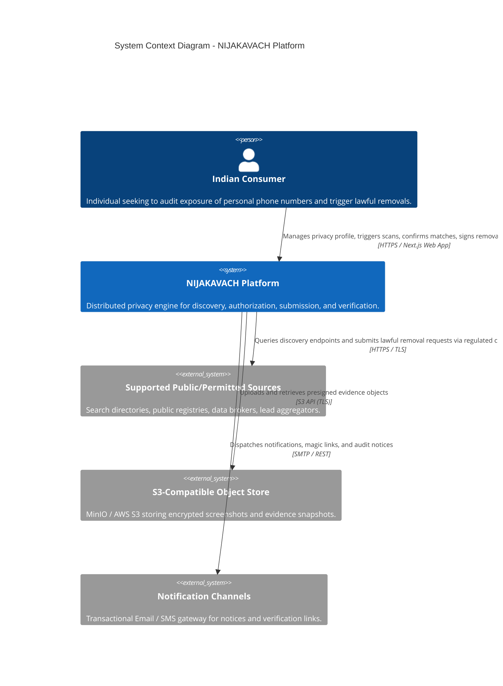
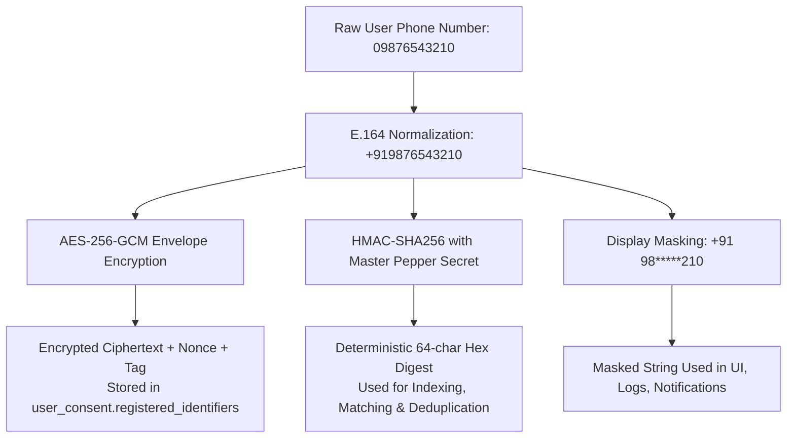

# NIJAKAVACH (निजकवच) — System Architecture Document

---

## 1. Architecture Overview

**NIJAKAVACH (निजकवच)** is an enterprise-grade privacy engineering platform engineered for Indian consumers to discover where their personal information (commencing with telephone numbers) is exposed across public directories, data brokers, and lead aggregators, and to orchestrate lawful, evidence-backed removal and opt-out workflows.

The system is architected as an event-driven, distributed microservices monorepo. It explicitly avoids monolithic coupling, synchronous request cascades, and opaque status claims. Every discovery, review, authorization, submission, tracking, and verification phase operates with explicit state boundaries and complete cryptographic auditability.

### Core Product Journey

```
[DISCOVER] ───> [REVIEW] ───> [AUTHORISE] ───> [SUBMIT] ───> [TRACK] ───> [VERIFY]
```

1. **DISCOVER**: Automated background scan jobs query lawful, public sources within legal and rate-limit constraints without bypassing access protections.
2. **REVIEW**: Consumers inspect discovered match candidates alongside immutable point-in-time cryptographic evidence (DOM snippet, SHA-256 digest, S3 storage key).
3. **AUTHORISE**: Consumer confirms whether a listing belongs to them and signs an explicit statutory authorization under **Section 12 of the Digital Personal Data Protection Act, 2023 (DPDP Act)** (Right to Correction and Erasure).
4. **SUBMIT**: Lawful removal payload is formatted and dispatched via supported channel (API, webform, or grievance email).
5. **TRACK**: Tracks source ticket IDs, acknowledgments, additional action requirements, or formal rejection notices.
6. **VERIFY**: Independent scheduled rechecks verify whether data was genuinely expunged, distinguishing source claims from independent verification, and actively surveillance sources for relisting.

> **CRITICAL ARCHITECTURAL DISTINCTION**:  
> A submitted request or source acknowledgement is **never** treated as a completed removal. Removal is only established after independent verification rechecks.

### High-Level System Context (C4 Context Diagram)



### Exposure Lifecycle State Machine

| State Code | State Name | Description | Transitions Allowed To |
| :--- | :--- | :--- | :--- |
| `POTENTIAL_EXPOSURE_DISCOVERED` | Potential Exposure Discovered | Raw match candidate detected by source worker. Awaiting user evaluation. | `MATCH_CONFIRMED`, `DISMISSED_AS_FALSE_POSITIVE` |
| `MATCH_CONFIRMED` | Match Confirmed | User confirmed the listing contains their personal data. | `AWAITING_USER_AUTHORISATION`, `CLOSED_NO_ACTION` |
| `DISMISSED_AS_FALSE_POSITIVE` | Dismissed False Positive | User confirmed the listing does not belong to them. | `CLOSED_NO_ACTION` |
| `AWAITING_USER_AUTHORISATION` | Awaiting Authorization | Case prepared; requires explicit electronic consent & authorization artifact. | `REQUEST_PREPARED`, `CLOSED_NO_ACTION` |
| `REQUEST_PREPARED` | Request Prepared | Removal payload generated with legal citations and required metadata. | `REQUEST_SUBMITTED`, `SUBMISSION_FAILED` |
| `REQUEST_SUBMITTED` | Request Submitted | Payload dispatched to source via API, webform, or compliance email. | `REQUEST_ACKNOWLEDGED`, `REQUEST_REJECTED`, `SUBMISSION_FAILED` |
| `REQUEST_ACKNOWLEDGED` | Request Acknowledged | Source ticket ID or acknowledgment response received. | `ADDITIONAL_ACTION_REQUIRED`, `SOURCE_REPORTS_REMOVAL`, `REQUEST_REJECTED` |
| `ADDITIONAL_ACTION_REQUIRED` | Additional Action Required | Source demands user verification, proof of identity, or supplementary data. | `REQUEST_SUBMITTED`, `CLOSED_UNRESOLVED` |
| `REQUEST_REJECTED` | Request Rejected | Source refused removal with formal justification or non-compliance. | `CLOSED_REJECTED`, `ESCALATED_MANUAL` |
| `SOURCE_REPORTS_REMOVAL` | Source Reports Removal | Source claims the data has been expunged or de-indexed. | `VERIFICATION_SCHEDULED` |
| `REMOVAL_INDEPENDENTLY_VERIFIED`| Removal Independently Verified | Re-check worker verified the target personal data is no longer accessible. | `MONITORING_ACTIVE` |
| `UNABLE_TO_VERIFY` | Unable to Verify | Endpoint timed out or source structure altered preventing verification. | `VERIFICATION_SCHEDULED`, `ESCALATED_MANUAL` |
| `INFORMATION_REAPPEARED` | Information Reappeared | Recurring monitor scan detected previously removed data has relisted. | `POTENTIAL_EXPOSURE_DISCOVERED`, `REQUEST_PREPARED` |

---

## 2. Technology Stack

| Layer | Technology | Version / Specification | Architectural Purpose |
| :--- | :--- | :--- | :--- |
| **Monorepo Engine** | Turborepo + pnpm | Turborepo 2.x, pnpm 12.x | High-performance build caching, strict package symlinks, isolated workspace graph. |
| **Frontend** | Next.js, React, Tailwind CSS | Next.js 14.x, React 18.x, Tailwind 3.4 | Responsive, accessible consumer portal with 6-stage journey tracking and evidence inspection. |
| **Backend Runtimes** | Node.js, TypeScript | Node.js 20/24 LTS, TypeScript 5.8 | Strict compiler mode (`noImplicitAny`, `noUncheckedIndexedAccess`, `strictNullChecks`). |
| **Primary Database** | PostgreSQL | PostgreSQL 16 Alpine | Relational transactional engine partitioned into 9 logical schemas with least-privilege roles. |
| **Coordination & Cache** | Redis | Redis 7 Alpine | Rate-limiting sliding windows, token blocklisting, distributed locks (Redlock). |
| **Message Broker** | RabbitMQ | RabbitMQ 3.13 Management | Durable work queues, Topic domain events, Dead-Letter Exchanges (`*.dlx`) with exponential backoff. |
| **Evidence Storage** | MinIO / AWS S3 | S3 API Compliant | Encrypted binary storage for screenshots, DOM snapshots, and statutory correspondence. |
| **Data Validation** | Zod | Zod 3.24 | Shared compile-time and runtime validation contracts across client and server. |
| **Security & Crypto** | Node.js Crypto, JWT | AES-256-GCM, HMAC-SHA256, Scrypt | Authenticated envelope encryption, keyed lookup indexing, password hashing, stateless tokens. |

---

## 3. Microservices and Responsibilities

```mermaid
graph TD
    Client[Next.js Web Frontend\napps/web :3000] -->|HTTPS / REST| Gateway[API Gateway / BFF\napps/api-gateway :4000]
    
    subgraph Synchronous Service Mesh
        Gateway -->|JWT / Internal Key| IdentitySvc[Identity Service\napps/identity-service :4001]
        Gateway -->|JWT / Internal Key| UserSvc[User & Consent Service\napps/user-service :4002]
        Gateway -->|JWT / Internal Key| SourceRegSvc[Source Registry Service\napps/source-registry-service :4003]
        Gateway -->|JWT / Internal Key| DiscoverySvc[Discovery Service\napps/discovery-service :4004]
        Gateway -->|JWT / Internal Key| CaseMgmtSvc[Case Management Service\napps/case-management-service :4005]
        Gateway -->|JWT / Internal Key| RemovalSvc[Removal Workflow Service\napps/removal-workflow-service :4006]
        Gateway -->|JWT / Internal Key| VerificationSvc[Verification Service\napps/verification-service :4007]
        Gateway -->|Internal Key| AuditSvc[Audit Service\napps/audit-service :4009]
    end

    subgraph Messaging & Worker Tier
        DiscoverySvc -->|Publish Scan Jobs| RabbitMQ[(RabbitMQ 3.13)]
        RabbitMQ -->|Consume Scan Jobs| SourceWorkers[Source Adapter Workers\napps/source-workers :4010]
        SourceWorkers -->|Publish CandidateFound| RabbitMQ
        RabbitMQ -->|Ingest Candidates| CaseMgmtSvc
        
        RemovalSvc -->|Publish Removal Jobs| RabbitMQ
        RabbitMQ -->|Consume Removal Submissions| SourceWorkers
        
        VerificationSvc -->|Publish Recheck Jobs| RabbitMQ
        RabbitMQ -->|Execute Recheck| SourceWorkers
        
        Outbox[Transactional Outbox Engines] -->|Publish Domain Events| RabbitMQ
        RabbitMQ -->|Events| NotificationSvc[Notification Service\napps/notification-service :4008]
        RabbitMQ -->|Security Events| AuditSvc
    end

    subgraph Data Tier (Logical Schemas in PostgreSQL 16)
        IdentitySvc --> DB_Id[(PostgreSQL: identity)]
        UserSvc --> DB_Usr[(PostgreSQL: user_consent)]
        SourceRegSvc --> DB_Src[(PostgreSQL: sources)]
        DiscoverySvc --> DB_Disc[(PostgreSQL: discovery)]
        CaseMgmtSvc --> DB_Case[(PostgreSQL: cases)]
        RemovalSvc --> DB_Rem[(PostgreSQL: removals)]
        VerificationSvc --> DB_Ver[(PostgreSQL: verification)]
        NotificationSvc --> DB_Notif[(PostgreSQL: notifications)]
        AuditSvc --> DB_Aud[(PostgreSQL: audit)]
        SourceWorkers --> S3[(MinIO / S3 Object Store)]
    end
```

### Microservice Catalog

| Service Name | Port | Owned Schema / Target | Primary Responsibilities |
| :--- | :--- | :--- | :--- |
| **API Gateway / BFF** (`apps/api-gateway`) | `4000` | Stateless (Redis) | Single public entry point, route dispatch, TLS termination, CORS, CSRF, security headers, correlation ID generation. |
| **Identity Service** (`apps/identity-service`) | `4001` | `identity` | Registration, Scrypt password hashing, session tokens, refresh token rotation, security event logging. |
| **User & Consent Service** (`apps/user-service`) | `4002` | `user_consent` | Phone number registration, HMAC-SHA256 fingerprinting, AES-256-GCM encryption, DPDP explicit consent records, erasure workflows. |
| **Source Registry Service** (`apps/source-registry-service`) | `4003` | `sources` | Supported source directory, capabilities (`SEARCHABLE`, `WEBFORM_OPT_OUT`, `EMAIL_NOTICE_REMOVAL`), rate limits, health metrics. |
| **Discovery Service** (`apps/discovery-service`) | `4004` | `discovery` | Orchestrates discovery scans across verified identifiers, dispatches jobs to RabbitMQ queues, monitors execution progress. |
| **Case Management Service** (`apps/case-management-service`) | `4005` | `cases` | Authoritative exposure state machine, match confirmation (`MATCH_CONFIRMED`), dismissal, presigned S3 evidence link generation. |
| **Removal Workflow Service** (`apps/removal-workflow-service`) | `4006` | `removals` | Prepares statutory DPDP Sec 12 notices, verifies explicit user electronic authorization, queues submission jobs, tracks acknowledgments. |
| **Verification Service** (`apps/verification-service`) | `4007` | `verification` | Independent rechecks ($T+24h$, $T+7d$, $T+30d$), relist detection (`ExposureRelisted`), strictly separates source claims from independent verification. |
| **Notification Service** (`apps/notification-service`) | `4008` | `notifications` | Transactional notifications (email/SMS alerts), delivery logs, user notification preferences. |
| **Audit Service** (`apps/audit-service`) | `4009` | `audit` | Centralized immutable append-only ledger with cryptographically chained SHA-256 block hashes (`entryHash = SHA256(prevHash + timestamp + payload)`). |
| **Source Workers** (`apps/source-workers`) | `4010` | S3 / MinIO | Asynchronous worker daemon processing discovery checks, removal submissions, and verification rechecks against lawful external endpoints. |
| **Web Frontend** (`apps/web`) | `3000` | Client UI | Next.js 14 client application with 6-stage privacy journey tracking, phone scanner, evidence snapshot inspector, and DPDP authorization. |

---

## 4. Service Communication

### A. Synchronous HTTP Ingress
- Client browser requests enter through the **API Gateway** (`apps/api-gateway:4000`) over HTTPS.
- Gateway injects standard security headers (`Content-Security-Policy`, `Strict-Transport-Security`, `X-Content-Type-Options: nosniff`, `X-Frame-Options: DENY`).
- Gateway generates a unique correlation ID (`X-Correlation-Id: corr-<uuid>`) if not present, and forwards requests to internal microservices with `X-User-Id` and `X-Internal-Service-Key`.

### B. Asynchronous Event-Driven Messaging
- RabbitMQ 3.13 acts as the central asynchronous nervous system.
- Exchange topology:
  - `nijakavach.jobs.direct`: Direct exchange for point-to-point worker tasks (`discovery.source-check`, `removal.submit`, `verification.recheck`).
  - `nijakavach.events.topic`: Topic exchange for distributed domain events (`nijakavach.#`).
  - Dead-Letter Exchanges (`jobs.discovery.dlx`, `jobs.removal.dlx`) capture poison pills and exhausted retries.
- Consumers acknowledge messages only after durable persistence (`ack`/`nack`). Retry policy uses exponential backoff with full jitter up to 5 attempts before routing to dead-letter queues.

---

## 5. Database Architecture

### A. Logical Schema Ownership & Role Isolation
To prevent the monolithic anti-pattern of cross-service table querying while keeping local operations lightweight, NIJAKAVACH uses **Logical Schema Partitioning** within PostgreSQL 16:

| Schema Name | Service Owner | Read/Write Role | Primary Entities |
| :--- | :--- | :--- | :--- |
| `identity` | Identity Service | `identity_svc_role` | `accounts`, `credentials`, `sessions`, `refresh_tokens` |
| `user_consent` | User & Consent Service | `user_svc_role` | `user_profiles`, `registered_identifiers`, `consent_records` |
| `sources` | Source Registry Service | `sources_svc_role` | `sources`, `source_capabilities`, `source_health` |
| `discovery` | Discovery Service | `discovery_svc_role` | `scans`, `scan_items`, `scan_job_dispatches` |
| `cases` | Case Management Service | `cases_svc_role` | `exposure_cases`, `evidence_snapshots`, `case_transitions` |
| `removals` | Removal Workflow Service | `removals_svc_role` | `removal_requests`, `authorisations`, `submissions` |
| `verification` | Verification Service | `verification_svc_role` | `verification_schedules`, `runs`, `recheck_observations` |
| `notifications` | Notification Service | `notifications_svc_role` | `notification_logs`, `preferences`, `templates` |
| `audit` | Audit Service | `audit_svc_role` | `audit_entries`, `compliance_checkpoints` |

Cross-schema foreign keys (`REFERENCES schema_b.table_y`) and cross-schema SQL joins are strictly prohibited. Inter-service relationships are maintained via UUID identifiers and communicated over REST or events. This guarantees zero schema refactoring when moving high-volume services to physically dedicated PostgreSQL clusters.

### B. Transactional Outbox Pattern
Each stateful service persists events to an internal `outbox_messages` table within its local transaction, eliminating dual-write race conditions between PostgreSQL and RabbitMQ:

```sql
CREATE TABLE outbox_messages (
    id UUID PRIMARY KEY DEFAULT gen_random_uuid(),
    aggregate_type VARCHAR(64) NOT NULL,
    aggregate_id VARCHAR(64) NOT NULL,
    event_type VARCHAR(128) NOT NULL,
    event_version VARCHAR(16) NOT NULL,
    payload JSONB NOT NULL,
    metadata JSONB NOT NULL,
    status VARCHAR(32) NOT NULL DEFAULT 'PENDING',
    retry_count INT NOT NULL DEFAULT 0,
    created_at TIMESTAMPTZ NOT NULL DEFAULT NOW(),
    dispatched_at TIMESTAMPTZ
);
CREATE INDEX idx_outbox_pending ON outbox_messages (status, created_at) WHERE status = 'PENDING';
```

---

## 6. Event-Driven Architecture

### Standard CloudEvents v1.0 Envelope

```typescript
export interface EventEnvelope<T = unknown> {
  specversion: "1.0";
  id: string;             // Unique event instance UUID
  type: string;           // E.g. "nijakavach.cases.match.confirmed"
  source: string;         // E.g. "urn:nijakavach:service:case-management"
  time: string;           // ISO 8601 UTC
  datacontenttype: "application/json";
  dataversion: string;    // Semantic payload version (e.g. "1.0.0")
  correlationid: string;  // Distributed tracing correlation ID
  data: T;                // Typed domain payload
}
```

### Event Registry Summary

| Event Type | Producer | Consumers | Business Purpose |
| :--- | :--- | :--- | :--- |
| `nijakavach.identity.user.registered` | Identity Service | `user-service`, `notification-service`, `audit-service` | New account initialized; provisions default privacy profile. |
| `nijakavach.user.consent.granted` | User Service | `audit-service` | Explicit DPDP statutory consent recorded. |
| `nijakavach.user.consent.withdrawn` | User Service | `discovery-service`, `verification-service`, `audit-service` | User revoked consent; immediately cancels all active scans. |
| `nijakavach.discovery.scan.requested`| Discovery Service | `source-workers`, `audit-service` | Queues discovery jobs for worker pool. |
| `nijakavach.worker.candidate.found` | Source Workers | `case-management-service` | Worker identified point-in-time exposure evidence. |
| `nijakavach.cases.match.confirmed` | Case Management | `removal-workflow-service`, `audit-service` | User confirmed match candidate belongs to them. |
| `nijakavach.removal.authorised` | Removal Service | `source-workers`, `audit-service` | User electronically signed DPDP Sec 12 removal notice. |
| `nijakavach.removal.submitted` | Source Workers | `removal-workflow-service`, `notification-service` | Removal payload dispatched to source endpoint. |
| `nijakavach.removal.source_reported` | Removal Service | `verification-service`, `case-management-service` | Source claims data expunged; triggers recheck schedule. |
| `nijakavach.verification.verified` | Verification Service | `case-management-service`, `notification-service` | Independent recheck confirmed data is unlisted. |
| `nijakavach.verification.relisted` | Verification Service | `case-management-service`, `notification-service` | Surveillance detected previously removed data relisted. |

---

## 7. Security and Privacy



1. **Deterministic Matching via HMAC-SHA256**: Raw phone numbers span a finite $10^{10}$ keyspace in India, making unsalted MD5/SHA256 trivially reversible via rainbow tables. NIJAKAVACH computes deterministic keyed HMAC-SHA256 using a secure master pepper secret. Database indexes and lookup queries operate solely on the HMAC digest.
2. **Envelope Encryption (AES-256-GCM)**: Decryptable values are stored encrypted with a 256-bit key managed externally, accessible only when generating formal statutory removal notices.
3. **Zero Plaintext PII in Telemetry**: Application loggers sanitize payloads, replacing phone numbers, passwords, authorization tokens, and secrets with `[REDACTED_PII]`.
4. **DPDP Act 2023 Alignment**:
   - Purpose Limitation (Section 5): Distinct consent scopes for discovery, removal submission, and monitoring.
   - Right to Withdraw Consent (Section 6(4)): Revocation halts active and recurring background scans immediately.
   - Right to Correction and Erasure (Section 12): Anonymizes identity records, purges registered identifiers, and strips evidence files from S3.

---

## 8. Scalability and Reliability

1. **Stateless Service Tier**: All API microservices are stateless. Authentication state is cryptographically self-contained in asymmetric JWTs or verified against distributed Redis session stores, allowing unconstrained horizontal scaling behind Layer 7 balancers.
2. **Worker Pool Auto-Scaling**: Source Adapter Workers scale horizontally based on RabbitMQ queue backlog (`jobs.discovery.source-check`, `jobs.removal.submit`).
3. **Circuit Breakers & Source Rate Limits**:
   - Circuit breakers monitor external source domains. If failure rates exceed 40% over a 1-minute sliding window, the breaker opens, failing fast and delaying subsequent source checks for 5 minutes.
   - Per-source rate limiting in Redis enforces external directory capacity limits and robots/ToS terms.
4. **Exponential Backoff with Jitter**:
   $$\text{Delay}(n) = \text{random}(0, \min(300000\text{ ms}, 1000\text{ ms} \times 2^n))$$
   Guarantees retry buffering without thundering herd failures.

---

## 9. Evidence Storage

1. **No Binary Blobs in PostgreSQL**: Screenshots, DOM snapshots, and statutory correspondence files are never stored in PostgreSQL `BYTEA` or text columns.
2. **S3 Object Architecture**: Binary evidence is streamed directly to S3-compatible Object Storage (MinIO locally, AWS S3/Cloudflare R2 in production) under server-side encryption (`AES256`).
3. **Storage Key Format**: `evidence/{case_id}/{snapshot_id}.enc`.
4. **Integrity & Access Control**:
   - SHA-256 digest is computed prior to upload and stored in PostgreSQL for tamper verification.
   - Consumer preview uses short-lived, presigned GET URLs (15-minute expiration) generated on-demand by the Case Management Service.

---

## 10. Deployment Architecture

```mermaid
graph TD
    subgraph Client Tier
        Browser[Modern Web Browser]
    end

    subgraph Edge & Ingress
        DNS[DNS / Cloudflare WAF] --> Ingress[L7 Load Balancer / Ingress Controller]
    end

    subgraph Service Mesh (Kubernetes / Containers)
        Ingress --> APIGW[API Gateway Pods 1..N]
        APIGW --> SvcMesh[Internal Service Pods\nIdentity, User, Sources, Discovery,\nCases, Removals, Verification, Audit]
        SvcMesh --> QueueBroker[RabbitMQ Cluster]
        QueueBroker --> WorkerPool[Worker Pods 1..M]
    end

    subgraph Managed Data Stores
        SvcMesh --> PostgresCluster[(PostgreSQL Cluster with Read Replicas)]
        SvcMesh --> RedisCluster[(Redis Sentinel / Cluster)]
        WorkerPool --> S3Bucket[(S3 Object Storage Bucket)]
    end

    Browser -->|TLS 1.3| DNS
```

- **Local Development**: Orchestrated via Docker Compose with dedicated containers for PostgreSQL 16, Redis 7, RabbitMQ 3.13, and MinIO.
- **Production Roadmap**: Designed for Kubernetes deployment with Helm charts, Horizontal Pod Autoscalers (HPA) driven by queue depth metrics, and AWS RDS/Aurora PostgreSQL.

---

## 11. Important Architectural Decisions

| ADR | Title | Decision Summary |
| :--- | :--- | :--- |
| **0001** | Microservices Monorepo with Turborepo & pnpm | Adopted pnpm workspaces + Turborepo to enforce zero phantom dependencies, rapid incremental builds, unified TypeScript configuration, and atomic schema/contract commits. |
| **0002** | Logical Schema Ownership & Least Privilege | Partitioned PostgreSQL into 9 non-overlapping schemas with dedicated service credentials. Prohibits cross-schema queries while preserving a single database instance for early operations. |
| **0003** | Asynchronous Messaging & Transactional Outbox | Adopted RabbitMQ for resilient job buffering and domain events. Enforced transactional outbox pattern to guarantee at-least-once delivery with consumer deduplication. |
| **0004** | Cryptographic PII Protection Standard | Enforced tripartite PII handling: E.164 normalization, AES-256-GCM envelope encryption at rest, and keyed HMAC-SHA256 fingerprinting for deterministic indexing. Prohibited raw PII in logs, URLs, and telemetry. |
| **0005** | Evidence Storage & Presigned URLs | Adopted S3-compatible object storage with SHA-256 integrity verification. Mediate client evidence viewing through 15-minute presigned URLs to keep database lightweight. |

---

## 12. Known Limitations and Future Considerations

1. **Statutory Notice Review**: Legal wording and formal DPDP Act Section 12 notice structures must receive formal sign-off from accredited Indian data protection counsel prior to commercial submission dispatches.
2. **KMS Envelope Key Rotation**: Local development manages cryptographic keys via environment variables. Production environments must bind to AWS KMS or GCP Cloud KMS with automated key rotation.
3. **Telecom SMS Gateway Integration**: Pre-registration OTP and phone ownership verification require a TRAI DLT-registered telecom header and SMS gateway provider.
4. **Physical Database Sharding Conditions**: If transaction volume on the `cases` or `discovery` schemas exceeds 10,000 writes/second, migrate those schemas to dedicated physical PostgreSQL instances using the established database-per-service logical boundaries.
